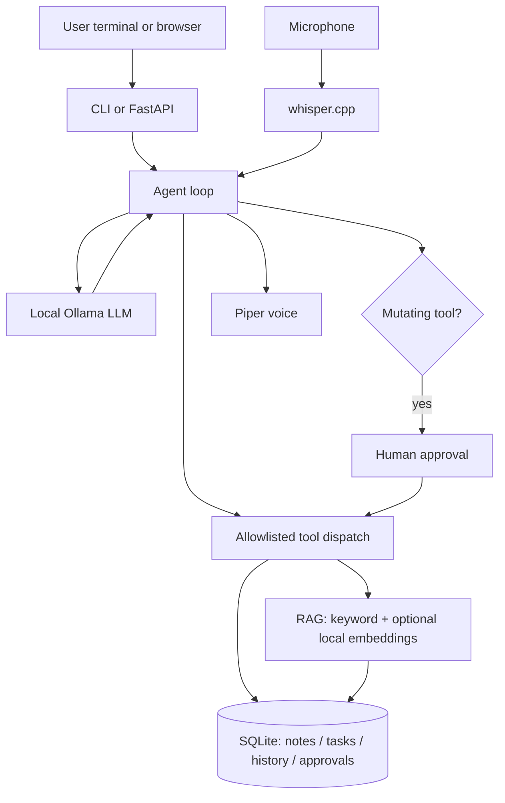

# BALAJI v1.0 — Architecture and trade-offs

- **Design intent:** deliver an inspectable, end-to-end agent MVP that runs on Linux and doesn't require API subscription fees.
- **Agent control:** bounded to 5 model turns; only explicitly exposed tool names accepted; parameters checked against schemas; tools cannot run shell commands or delete files.
- **Approvals:** terminal path blocks for explicit yes/no; browser path stores a pending approval token and waits for explicit action. Approval execution transitions atomically to `processing`, which avoids duplicate execution from repeated approve requests. Multi-step agent plans need a follow-up user request after browser approval.
- **Storage:** single-user local SQLite. Concurrency is adequate for one local browser / terminal user, but not a distributed multi-user service.
- **RAG:** keyword matching works without an embedding model. Optional local `/api/embed` vectors improve semantic retrieval. The retrieved passages are presented as untrusted data; source references are filenames/page/chunk labels. No claimed benchmark for retrieval quality.
- **Voice:** ALSA/PulseAudio recording, 16kHz mono WAV, whisper.cpp CLI transcription, Piper synthesis, aplay; hardware and environment dependencies are external to the Python unit tests.
- **Threat model:** local-only machine; no public API authentication; malicious uploaded documents may contain prompt injections, so don't use the current app for high-impact autonomous decisions. Do not expose its API to a network without additional security.
- **Next production milestone:** stronger auth, encrypted or segmented personal data, observability/evaluations, LangGraph checkpoints, improved RAG recall, automatic approval-resume and desktop integrations with scoped permissions.
